Following the release of the [Edgerunners S2 official teaser #2](), I have become increasingly convinced that a major conflict in Edgerunners S2 will be to do with a blackwall AI. Theres various things that have convinced me, but lets start with the overall theory. Throughout the trailer, once the action section starts, we regularly see streaks of red lightning as a visual effect, which is often accompanied by various hack-y, tech-y things happening, including notably cars seemingly being piloted by the lightning careening towards one of our main characters, D. Whatever they are, these lightning bolts seem to have a notable driving force on the plot (no pun intended) - there is something behind them that seems less than fond of our main characters.

From discussing this with friends, and [reading around a little online](https://www.reddit.com/r/LowSodiumCyberpunk/comments/1uj00vb/looks_like_were_getting_more_of_the_blackwall_in/) (the post was deleted when I got there too, see comments), I saw two conflicting opinions on what the red lightning was:

1. Its a blackwall AI
2. Its quickhacks

I still think that number 1 is more convincing, but lets break down the red lightning scenes from the teaser frame by frame to see why.

# Breaking down the red lightning

I am going to go through each scene where red lightning appears and break down exactly what happens and my thoughts

## Literally the first few frames

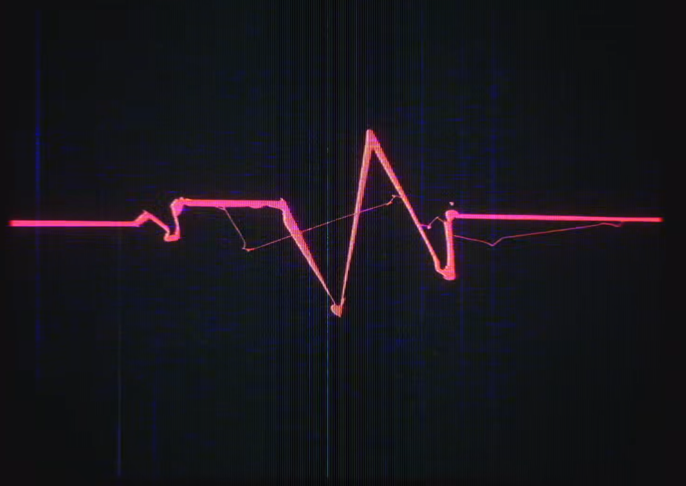

The first appearance of the lightning is in literally the first few frames. It flashes across the screen before the CD Projekt Red logo. This suggests to me it is a key motif of season 2, not just a random side thing. 

## D Flashback, maybe?

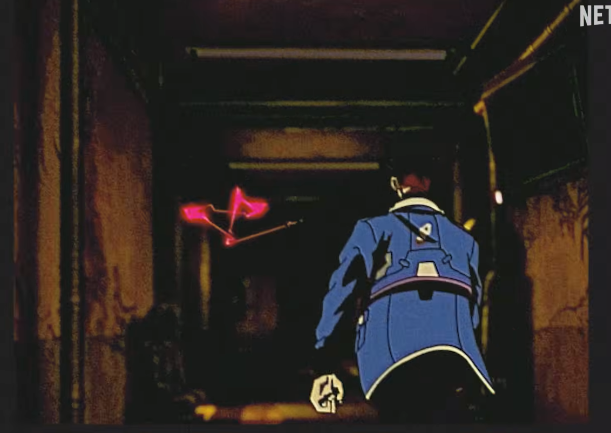

The next appearance of the lightning is seemingly in a flashback / memory for D, or it is from the POV of a camera, which seems equally likely considering the media spin of the season. He is seen running down a corridoor, with the red lightning bouncing around the walls ahead of him. The reason I think this is a flashback and not real time is because of the faded look of the scene, but even if isn't, it seems to set up a different lightning appearance a few scenes later that I'll talk about next

## Deja Vu

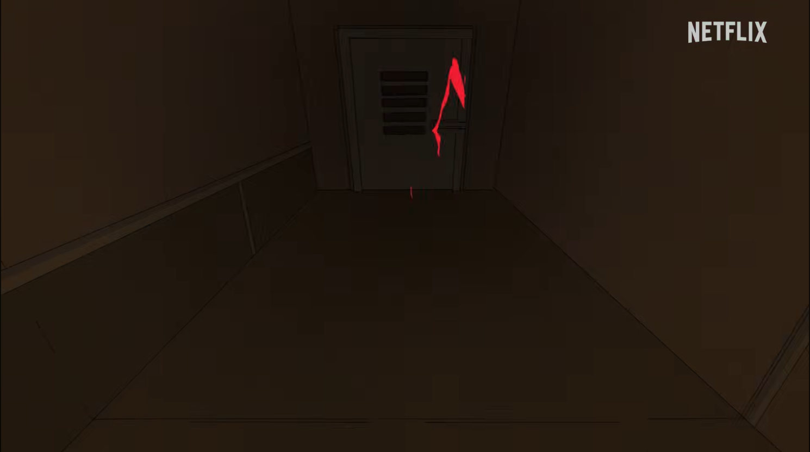

A few scenes later, we get a long-ish running sequence down a familiar looking brown corridoor. The familiarity of the scene (dimly lit, brown corridoor with lightning, character running down it) makes me think that either this is a reliving, a different POV, or a repeat, of the previous scene red lightning scene, and that our POV character is D. Notably, this time rather than appearing to be chasing after, the red lightning seems to be helping our unnamed POV character out here. This is where the quickhacks allegations start to have get the arguments.

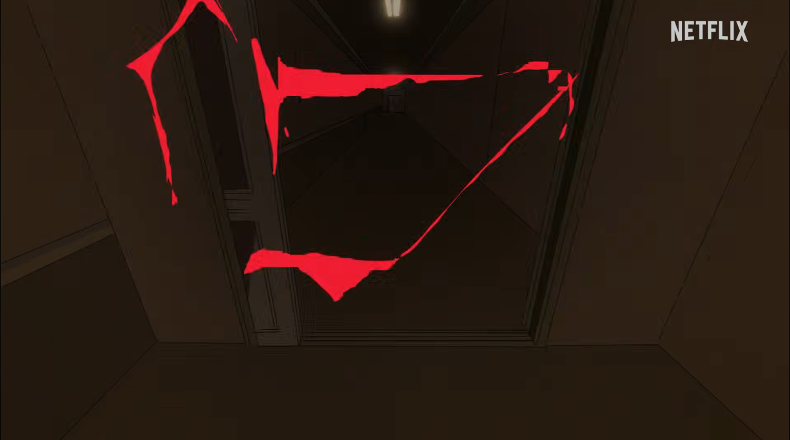

It looks like the red lightning is pulling the doors open as our POV runs, which seems exactly like a quickhack type situation - and if we believe that this is a repeat of the previous scene, then this would put us in the shoes of D, who is a netrunner. This makes it quite believable that the doors being pulled open are through quickhacks rather than any more sinister influence. However, what happens next brings me back towards blackwall AI.

## Chomp

I'm gonna put a few frames that happen in order just right next to each other here

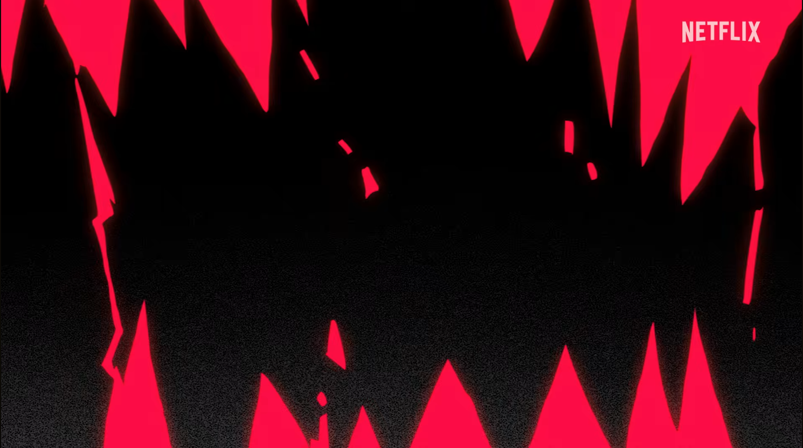

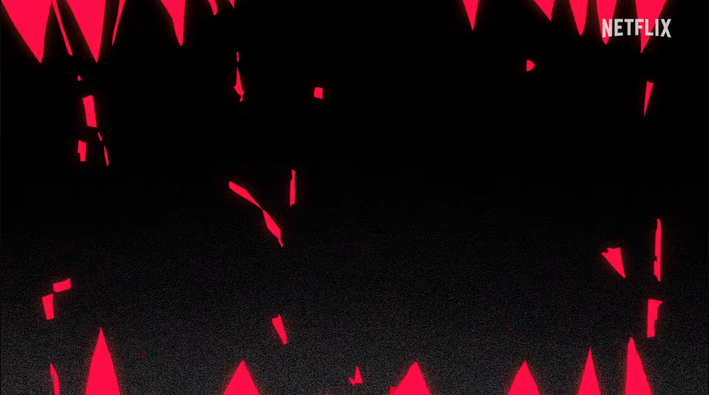

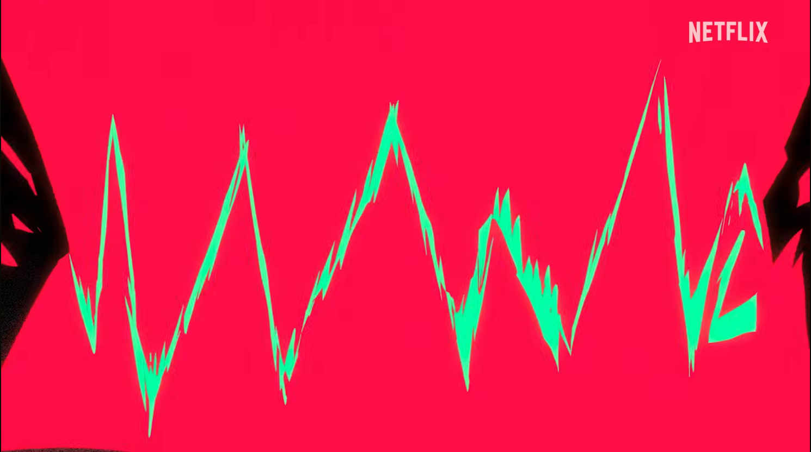

These appear right after the corridoor running scene, making me think that this is a continuation of the lightning (also its the same colour), and while you might have blinked and missed it on your first watch through (it happens over maybe 10 frames), it looks pretty clearly like teeth biting down to me - and that doesn't seem very quickhacksy to me...

This seems like exactly the sort of thing that suggests the red lightning has a more external force behind its actions - if the red lightning is just D or another netrunner, why are they making teeth out of it.

## Vehicular manslaughter

We slam cut to a dramatic Dolly zoom out of D's face

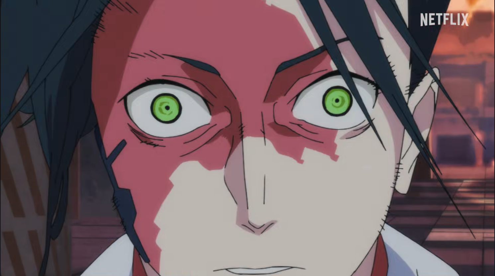

and a car puppeteered by red lightning barrels around the corner

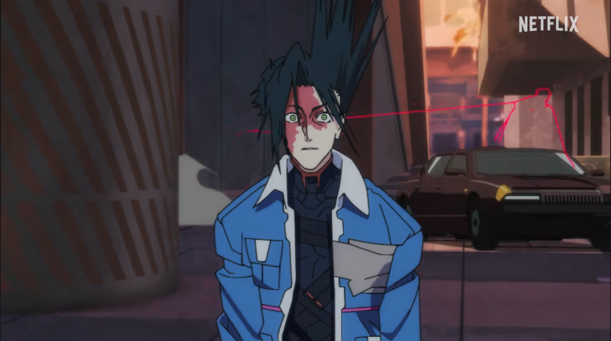

with D seemingly still locked out. The car moves erratically, bouncing against the wall, suggesting to me that its definitely not under the control of its occupants, but rather the red lightning. It appears to be animated almost animalistically, as if it is winding up to pounce at various points rather than driving like a normal car would. At the last moment of it hitting D we get a shot of the red lightning slamming the brakes on suddenly and the car goes flipping over D's head - this shot shows an empty driving seat so definitely being hacked.

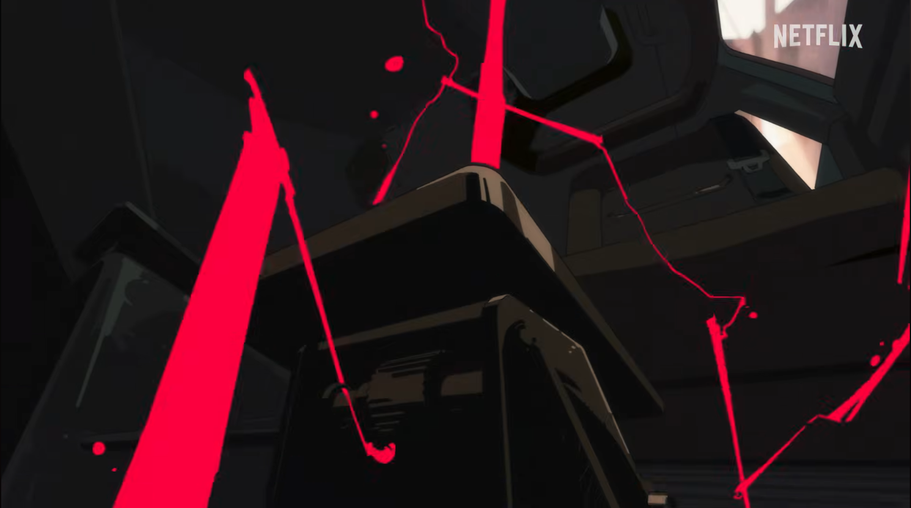

But he's not safe yet, as following an explosion, our zoned out boy is approached by two more cars bounding onto the intersection, trailing red lightning - whatever is attacking him has eyes in multiple places, and isn't giving up.

## Electrocute the rich

We then have a series of shots that look like they were recorded on a camera of Arasaka coming under some kind of cyber attack maybe? Various fires and explosions happen seemingly unprompted, and various corpo types seem to have spontaneous chrome malfunctions. This might be general news feeds, or might be part footage from the mini media kid. Theres no red lightning, but that doesn't surprise me if this is camera feeds, and it seems to set up some powerful hacking force - maybe a netrunner, or maybe a blackwall AI...

## Reach for the stars

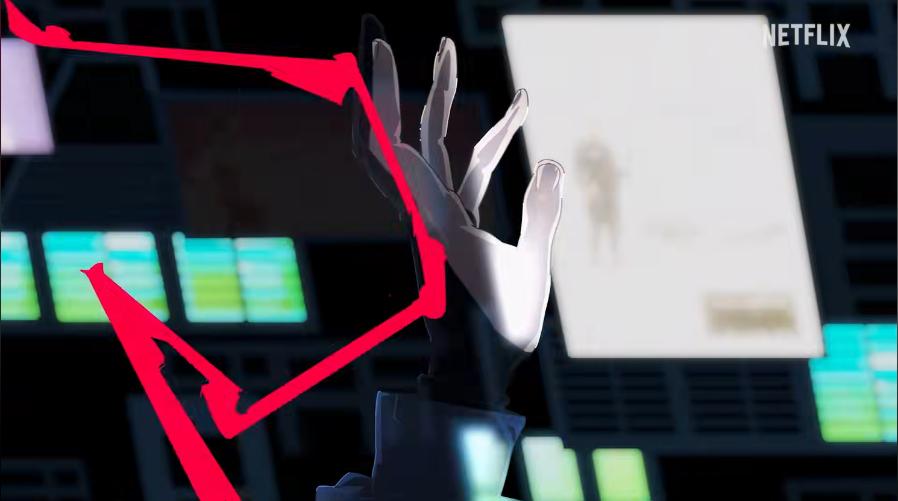

The next appearance of the red lightning is of D's hand reaching up through a netrun with red lightning around it. This seems to almost confirm that the red lightning is in some way involved with D - if hes netrunning and its there, its gotta be either with him or trying to stop him.

## And thats all

The teaser ends with the logo in some general net-esque looking scenarios. It reminds me of some of how the blackwall / net in general is portrayed in Cyberpunk 2077 but I havent actually played that game.

## JK

In a few frames post title scene but before the approximate release date, we get some more red lightning action. The most interesting frame is this one:

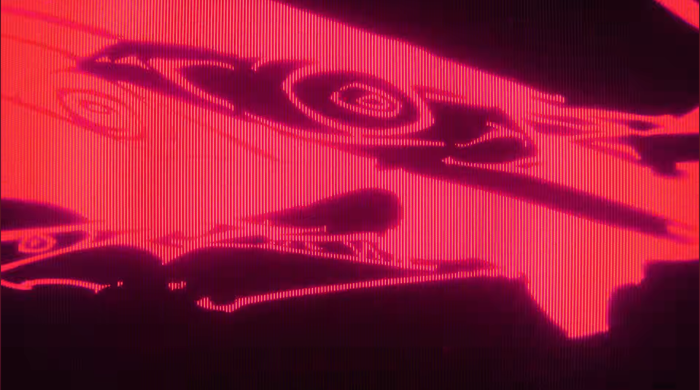

Which almost seems a little face like, though maybe that is stretching it a bit far. Definitely reinforces that this is a strong motif.

# So what does this mean

In my opinion, the actions taken by the red lightning throughout the trailer suggest much more it being a blackwall AI than it being some skilled hacker. The fact that the lightning sometimes seems to work with D, while other times seeming to attack him, suggests to me a complicated external party in the show that will be bouncing around in its opinion - potentially its confused, or potentially it only acts in its own interest. Additionally, it is personified enough to make me think this is not just a team of netrunners.

The idea of the main plot tension revolving around a blackwall AI seems to fit for me in multiple ways. It is well known that many organisations in the Cyberpunk universe are interested in finding, destroying, or controlling, a blackwall AI, and so one suddenly on the loose, especially if it is uncovered by D, would place a target on the backs of our MCs that seems exactly the kind of inciting incident we are looking for. Additionally, the cyberpunk breezewiki says this on D's page:

> However, this deadly search brought D to discover corporate secrets that were never meant to be found

[D's wiki page](https://breezewiki.com/cyberpunk/wiki/D_(Edgerunners))

Which would make sense if he discovered a blackwall AI. The whole show seems to have suggestions of uncovering truths that were best kept hidden, digging too deep and catching people's attention, and I think the inclusion of the little media kid who is described as obsessed with documenting the truth definitely won't help the rest of the group keep things hushed up.

Additionally, a show about AI destruction and devastation seems especially topical at the moment, as we seem to be increasingly barrelling towards our own version of a Cyberpunk dystopia in real life. Maybe the writers are inspired by some real goings on.

In conclusion I pretty strongly believe that there will be a blackwall AI present in season 2 - my prediction for the plot is that D unwittingly stumbles across the AI as he is digging into Arasaka, and it ends up escaping containment using him as a semi vessel. From there hijinks ensue as different factions catch wind of the AI on the loose and want to take control, and our MCs are hunted down and have to fight off factions and each other to stay alive. But whether or not I am right, I'm hyped for the season and think its gonna be pretty epic.

_If you want to build off my ideas, please credit me. If you want to add any thoughts, or if you write a post of your own, feel free to open a PR to link to your post / add a section of your thoughts here_
